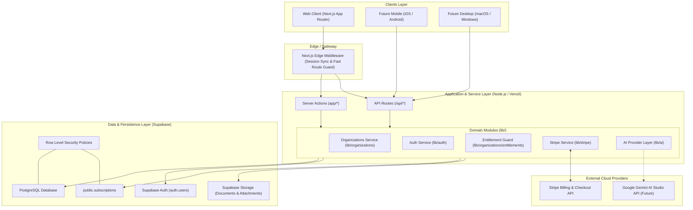

# System Architecture: Company Brain

---

## 1. Architectural Principles

- **Separation of Concerns**: UI components never make direct database queries or interact directly with third-party SDKs. All operations are mediated through domain services (`lib/`).
- **Strict Decoupling of Auth & Entitlement**: Authenticated status does not imply application access. Product access requires an active trial or paid subscription linked to the user's active organization.
- **Server Components First**: Next.js App Router Server Components handle initial data fetching on the server, minimizing client JavaScript bundle sizes.
- **Strict Row-Level Isolation**: Supabase PostgreSQL Row Level Security (RLS) is the bedrock of multi-tenancy. Even if an application bug omitted a tenant filter, the database rejects unauthorized access.
- **Cross-Platform Compatibility**: Application business logic is structured into clean services and REST/Action endpoints that can serve web, mobile (iOS/Android via React Native/Flutter), and desktop clients (macOS/Windows via Electron or Tauri).

---

## 2. High-Level System Diagram



---

## 3. End-to-End Access Control Chain

Access to the core application (`/dashboard/*`) is governed by an explicit 4-step authorization sequence executed server-side:

```text
[HTTP Request]
       │
       ▼
1. hasAuthenticatedUser()?
       ├─ No  ──► Redirect to /login
       └─ Yes
            │
            ▼
2. hasOrganization()?
       ├─ No  ──► Redirect to /onboarding
       └─ Yes
            │
            ▼
3. hasActiveEntitlement()?
       ├─ Query public.subscriptions for activeOrg.id
       ├─ Check status in ('trialing', 'active')
       ├─ No  ──► Redirect to /pricing?reason=subscription_required
       └─ Yes
            │
            ▼
4. [Grant Access to /dashboard/*]
```

---

## 4. Multi-Tenant Scoping Strategy

Every tenant in Company Brain corresponds to an `organizations` row.

### Workspace Context Resolution
1. **Active Organization Cookie**: For the web client, the active organization is tracked via a secure, HTTP-only cookie `cb_active_org_id`.
2. **HTTP Header Fallback**: For API requests and native clients, requests can supply `X-Organization-Id: <uuid>`.
3. **Server-Side Validation**:
   - The server queries `public.organization_members` to ensure the current authenticated user (`auth.uid()`) belongs to the requested organization with a valid role.
   - If no valid active organization is detected, the server automatically defaults to the user's primary organization or redirects to `/onboarding`.

---

## 5. Authentication Architecture

- **Supabase SSR**: Authentication tokens are stored in HTTP-only, secure, same-site cookies managed by `@supabase/ssr`.
## 5. Authentication Architecture

- **Supabase SSR**: Authentication tokens are stored in HTTP-only, secure, same-site cookies managed by `@supabase/ssr`.
- **Supported Providers (Phase 0.5)**:
  - Email + Password (with required Terms of Service consent and optional Marketing consent).
  - GitHub OAuth (`signInWithOAuth({ provider: 'github' })`).
  - Forgot / Reset Password flow via email recovery links.
  - *(Google OAuth deferred to future phase)*.
- **Supabase Client Architecture**:
  1. `lib/supabase/client.ts`: Browser client for client components using `NEXT_PUBLIC_SUPABASE_PUBLISHABLE_KEY`.
  2. `lib/supabase/server.ts`: Server client using cookies for Server Components, Server Actions, and Route Handlers, plus `createServiceClient()` for standalone background tasks / webhooks using PostgreSQL `SECURITY DEFINER` RPCs.
  All operations strictly rely on `NEXT_PUBLIC_SUPABASE_URL` and `NEXT_PUBLIC_SUPABASE_PUBLISHABLE_KEY`.

---

## 6. Stripe Billing & Trial Architecture

- **Decoupled Configuration** (`lib/stripe/config.ts`):
  Defines business tiers (`starter`, `pro`, `enterprise`) and quotas independently of Stripe price IDs.
- **Server-Side Price ID Mapping**:
  Client components transmit only the internal plan identifier. The server maps this to the corresponding Stripe Price ID retrieved from server environment variables (`STRIPE_STARTER_PRICE_ID`, etc.).
- **Customer Deduplication**:
  Before creating a Stripe Customer, the server checks the `subscriptions` table and searches the Stripe API for customers with `metadata['organization_id'] = activeOrg.id`. This guarantees zero duplicate customers in Stripe.
- **Trial Period Configuration**:
  Trials are configured via `TRIAL_DAYS` (default 7) and injected into the Stripe Checkout session under `subscription_data.trial_period_days`.
- **Cryptographic Webhook Verification & Lifecycle Synchronization**:
  `app/api/webhooks/stripe/route.ts` verifies incoming webhook signatures using `STRIPE_WEBHOOK_SECRET` before dispatching database synchronization events.
  Handles all key lifecycle events:
  - `checkout.session.completed`
  - `customer.subscription.created`
  - `customer.subscription.updated`
  - `customer.subscription.deleted`
  - `customer.subscription.trial_will_end`
  - `invoice.paid` / `invoice.payment_succeeded`
  - `invoice.payment_failed`
- **Canonical Source of Truth**:
  Client-side `success=true` query parameters are never trusted. Product entitlement is granted only when the verified Stripe webhook state is recorded in `public.subscriptions`.
