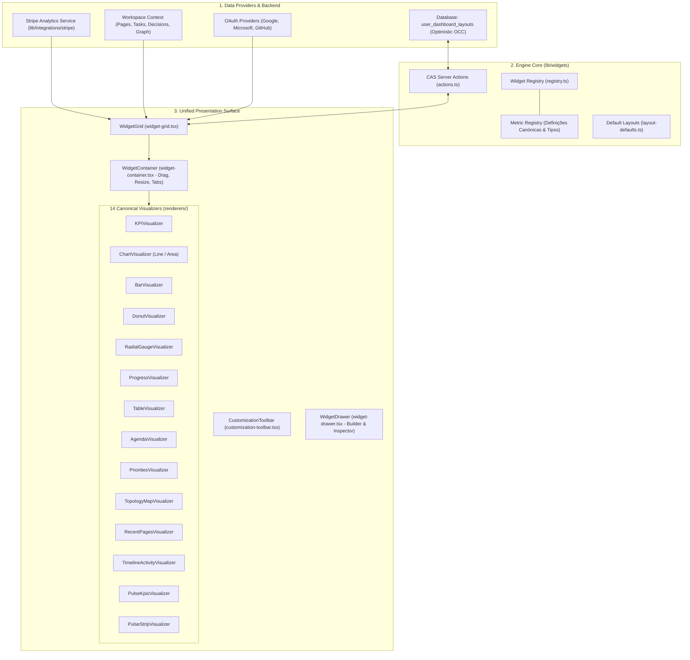

# Universal Dashboard Engine — Arquitetura e Manual Técnico

> **Status**: Estabilizado & Homologado (40/40 suites de teste aprovadas)  
> **Escopo**: Home Dashboard (`/dashboard`), Finance Dashboard (`/dashboard/finance`), e futuros dashboards analíticos.  
> **Princípio Central**: O `WidgetGrid` é a superfície de renderização única e canónica de dashboards do BusinessBrain. Zero componentes paralelos, zero métricas fictícias.

---

## 1. Visão Geral da Arquitetura

O Universal Dashboard Engine unifica toda a renderização analítica do BusinessBrain sob um pipeline modular, reativo e seguro:

---

## 2. Widget Registry & Metric Registry

O registo (`lib/widgets/registry.ts`) funciona como o contrato canónico de capacidades entre a camada de dados e os componentes visuais.

### 2.1 Categorias de Métricas

1. **Financeiras (`finance.*`)**:
   - `finance.net_revenue`: Receita líquida agregada do período selecionado (`cents`, `period_aggregate`).
   - `finance.gross_revenue`: Faturação bruta acumulada (`cents`, `period_aggregate`).
   - `finance.mrr`: Monthly Recurring Revenue em vigor (`cents`, `point_in_time`).
   - `finance.arr`: Annual Run-Rate estimado (`cents`, MRR × 12).
   - `finance.active_subscriptions`: Número de subscrições ativas (`count`, `point_in_time`).
   - `finance.active_customers`: Clientes pagantes únicos com subscrições ativas (`count`).
   - `finance.churn_rate`: Taxa de cancelamento de subscrições (`percentage`).
   - `finance.retention_rate`: Taxa de retenção de clientes (`percentage`).
   - `finance.arpu`: Receita média por subscrição (`cents`).
   - `finance.clv`: Customer Lifetime Value projetado (`cents`).
   - `finance.fees`: Taxas e custos operacionais de processamento (`cents`).
   - `finance.refunds`: Reembolsos emitidos no período (`cents`).
   - `finance.revenue_chart`: Série temporal de receita e evolução financeira (`currency_timeseries`).
   - `finance.plans_breakdown`: Distribuição de receita por plano de subscrição (`plans_distribution`).
   - `finance.recent_transactions`: Registo das transações mais recentes (`transactions_list`).
   - `finance.subscriptions_list`: Tabela das subscrições e planos da organização (`subscriptions_table`).
   - `finance.saas_unit_economics`: Resumo completo de economia unitária SaaS (`unit_economics`).

2. **Workspace & Inteligência Organizacional (`workspace.*`)**:
   - `workspace.pulse`: Visão consolidada de pulso executivo com métricas financeiras e de workspace.
   - `workspace.topology`: Grafo de conexões entre entidades da empresa (Pages, Decisions, Projects).
   - `workspace.recent_pages`: Páginas documentadas recentemente editadas ou visitadas.
   - `workspace.priorities`: Decisões urgentes e tarefas pendentes que requerem ação executiva.
   - `workspace.timeline`: Eventos e marcos históricos na timeline da organização.
   - `workspace.tasks`: Lista de tarefas operacionais ativas com filtros de estado.
   - `workspace.projects`: Portfólio de projetos ativos e prazos.
   - `workspace.decisions`: Registo de decisões arquiteturais e operacionais.

3. **Integrações Externas (`external.*`)**:
   - `external.google_calendar`: Eventos e reuniões agendadas via Google Workspace OAuth.
   - `external.microsoft_calendar`: Calendário e eventos sincronizados via Microsoft 365 OAuth.
   - `external.github_activity`: Pull Requests e commits recentes sincronizados via GitHub App.

---

## 3. Visualizers Disponíveis (14 Renderers Oficiais)

Localizados em `components/dashboard/widgets/renderers/`:

| Visualizer | Ficheiro | Tipos Suportados | Descrição |
| :--- | :--- | :--- | :--- |
| **KPI** | `kpi-visualizer.tsx` | Contagem, moeda, percentagem | Cartão numérico minimalista com delta direcional e período. |
| **Chart** | `chart-visualizer.tsx` | Série temporal (Linha, Área) | Gráfico SVG interativo com gradiente e tooltips pontuais. |
| **Bar** | `bar-visualizer.tsx` | Barras verticais | Comparação de períodos ou métricas categóricas. |
| **Donut** | `donut-visualizer.tsx` | Fatias percentuais | Distribuição de planos, estados de tarefas ou origens. |
| **Radial Gauge**| `radial-gauge-visualizer.tsx`| Medidor de arco radial | Medidor percentual de metas e taxas de retenção/atingimento. |
| **Progress** | `progress-visualizer.tsx` | Barra de progresso linear | Atingimento de metas em percentagem e frações. |
| **Table** | `table-visualizer.tsx` | Listas tabulares estruturadas | Transações, subscrições, tarefas e decisões com paginação. |
| **Agenda** | `agenda-visualizer.tsx` | Eventos de calendário | Listagem de compromissos com badges de horário e sala. |
| **Priorities** | `priorities-visualizer.tsx` | Ações executivas prioritárias | Destaque para decisões pendentes e tarefas de alta prioridade. |
| **Topology** | `topology-map-visualizer.tsx` | Grafo de nós e arestas | Estatísticas e atalho para o grafo de conhecimento da empresa. |
| **Recent Pages**| `recent-pages-visualizer.tsx`| Páginas recentes | Acesso rápido a documentos com ícones personalizados. |
| **Timeline** | `timeline-activity-visualizer.tsx`| Marcos históricos | Feed vertical de eventos organizacionais recentes. |
| **Pulse** | `pulse-kpis-visualizer.tsx` | Métricas 4x1 combinadas | Grade unificada de 4 KPIs essenciais do negócio. |
| **Strip** | `pulse-strip-visualizer.tsx` | Barra horizontal de pulso | Faixa compacta de indicadores de topo de dashboard. |

---

## 4. Persistência de Layouts & Controlo de Concorrência (CAS)

Os layouts dos utilizadores são persistidos de forma atómica na tabela `user_dashboard_layouts` da base de dados PostgreSQL.

### 4.1 Esquema e RLS
- **Tabela**: `user_dashboard_layouts`
- **Chaves**: `(user_id, organization_id, dashboard_type)`
- **Campos**: `layout jsonb`, `version int`, `updated_at timestamptz`.
- **Isolamento**: Protegido por RLS estrito via `auth.uid()` e adesão ativa à organização.

### 4.2 Mecanismo Compare-and-Swap (CAS)
Para evitar que alterações simultâneas em múltiplos separadores ou dispositivos sobrescrevam layouts de outros membros:
1. Ao carregar o layout, o cliente recebe `updatedAt`.
2. Ao gravar via `saveDashboardLayoutAction`:
   - Envia `expectedUpdatedAt`.
   - Se o registo no banco foi alterado por outra sessão entretanto (`updated_at != expectedUpdatedAt`), a mutação falha com código `CONFLICT`.
   - O utilizador é notificado na UI (`CustomizationToolbar`) com opções para:
     - **Recarregar a versão mais recente** do servidor.
     - **Forçar sobrescrita** (quando expressamente pretendido pelo utilizador).

---

## 5. Configuração de Widgets no Dashboard Builder

O `WidgetDrawer` (`components/dashboard/widgets/widget-drawer.tsx`) permite aos utilizadores personalizar livremente o seu dashboard:

- **Seleção de Métrica**: Filtrada pelas categorias permitidas para o dashboard atual.
- **Visualizador Dinâmico**: Apenas renderers compatíveis com a semântica da métrica são disponibilizados.
- **Tamanhos Suportados**:
  - `sm` (1 coluna no grid de 4 colunas - 25% da largura).
  - `md` (2 colunas - 50% da largura).
  - `lg` (3 colunas - 75% da largura).
  - `full` (4 colunas - 100% da largura).
- **Opções Avançadas**:
  - Título customizável.
  - Intervalo de tempo (`30D`, `90D`, `12M`, `YTD`, `ALL`, `current`).
  - Granularidade de gráfico (`day`, `week`, `month`).
  - Quebra de linha forçada (`rowBreak`).
  - Abas compostas (múltiplas métricas num único widget com abas alternáveis).

---

## 6. Tratamento de Providers Indisponíveis & Segurança de Dados

O BusinessBrain aplica um princípio estrito de **integridade de dados**:
1. **Zero Dados Falsos**: Se o Stripe não estiver configurado ou conectado para a organização, as métricas exibem um estado amigável de conexão necessária (`isStripeConnected === false`), sem injetar números aleatórios ou fictícios.
2. **Moedas Isoladas**: Valores monetários são estritamente mantidos na sua moeda nativa (EUR, USD, GBP) sem conversão arbitrária entre moedas na mesma métrica agregada.
3. **Isolamento de Erros por Widget**: Cada widget é envolvido por uma `WidgetErrorBoundary`. Se um componente ou fonte de dados lançar uma exceção de runtime, apenas aquele widget exibe um cartão de erro e botão de retry; os restantes widgets continuam funcionais e navegáveis.

---

## 7. Requisitos de Autenticação & OAuth

Para métricas baseadas em integrações de terceiros:
- **Stripe**: Requer credenciais configuradas na organização (`stripe_account_id` ou chaves de API restritas).
- **Google Workspace**: Requer tokens OAuth com escopos mínimos de leitura de eventos (`https://www.googleapis.com/auth/calendar.readonly`).
- **Microsoft 365**: Requer consentimento de permissão Graph (`Calendars.Read`).
- **GitHub**: Requer autenticação via GitHub App ou Personal Access Token com escopo `repo`.

---

## 8. Critérios e Procedimento para Adicionar Novos Widgets

Qualquer novo widget no BusinessBrain deve seguir rigorosamente os seguintes 8 passos:

1. **Registo no Metric Registry (`lib/widgets/registry.ts`)**:
   Definir o ID único da métrica, unidade (`cents`, `count`, `percentage`, etc.), semântica temporal (`point_in_time` ou `period_aggregate`), visualizadores suportados e dashboards autorizados.
2. **Declaração de Fonte de Dados Real**:
   Garantir que a métrica mapeia para um serviço real existente em `lib/` (ex: `lib/integrations/stripe`, `lib/timeline`, `lib/organizations`). Proibido criar métricas puramente estáticas ou simuladas.
3. **Compatibilidade com Visualizer**:
   Utilizar um dos 14 visualizadores existentes ou, caso seja estritamente necessário um novo visualizador, implementá-lo em `components/dashboard/widgets/renderers/` com suporte a `loading`, `empty`, `error` e dark/light mode.
4. **Respeitar Permissões e RLS**:
   Validar se o utilizador tem a permissão requerida (ex: `finance.view` para métricas de receita) antes de renderizar o widget.
5. **Suporte a Light & Dark Mode**:
   Utilizar exclusivamente variáveis de design tokens semânticos (`border-border-subtle`, `bg-card`, `text-foreground`, `text-muted-foreground`). Proibido hardcoding de cores que quebrem em qualquer um dos temas.
6. **Internacionalização (i18n)**:
   Adicionar chaves de tradução nos 4 idiomas oficiais (`en`, `pt`, `es`, `fr`) em `lib/i18n/dictionaries/`.
7. **Navegação de Retorno**:
   Widgets com detalhe devem incluir link para a página completa de origem (ex: `/dashboard/finance` ou `/dashboard/pages/[id]`).
8. **Cobertura de Testes**:
   Adicionar ou atualizar a suite de testes em `scripts/test-universal-dashboard-builder.ts` e `scripts/test-e2e-universal-dashboard.ts` validando a adição.
