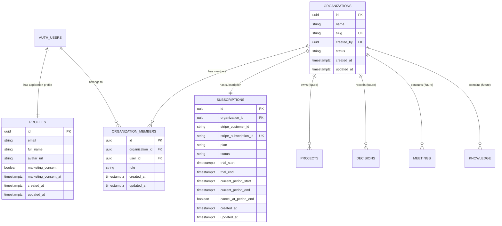

# Database Architecture & Entity Specifications: Company Brain

---

## 1. Schema Overview & Entity Relationship

---

## 2. Implemented Tables (Phase 0 & 0.5)

### 2.1 `profiles`
Stores application-level metadata for authenticated users.

| Column | Type | Constraints | Description |
|---|---|---|---|
| `id` | `uuid` | Primary Key, references `auth.users(id)` ON DELETE CASCADE | Matches auth user ID |
| `email` | `text` | `NOT NULL` | User email address |
| `full_name` | `text` | Nullable | User display name |
| `avatar_url` | `text` | Nullable | Optional profile avatar image URL |
| `marketing_consent` | `boolean` | `NOT NULL DEFAULT false` | Captured during registration |
| `marketing_consent_at` | `timestamptz` | Nullable | Timestamp when marketing consent was given |
| `created_at` | `timestamptz` | `NOT NULL DEFAULT now()` | Timestamp of creation |
| `updated_at` | `timestamptz` | `NOT NULL DEFAULT now()` | Auto-updated via trigger |

### 2.2 `organizations`
Represents the company, workspace, and multi-tenant boundary.

| Column | Type | Constraints | Description |
|---|---|---|---|
| `id` | `uuid` | Primary Key, `DEFAULT gen_random_uuid()` | Unique tenant identifier |
| `name` | `text` | `NOT NULL` | Display name of the company |
| `slug` | `text` | `NOT NULL UNIQUE` | URL-safe workspace slug |
| `created_by` | `uuid` | Nullable, references `auth.users(id)` ON DELETE SET NULL | Founder/Creator user |
| `status` | `text` | `NOT NULL DEFAULT 'active'`, check `('active','suspended','archived')` | Tenant lifecycle status |
| `created_at` | `timestamptz` | `NOT NULL DEFAULT now()` | Creation timestamp |
| `updated_at` | `timestamptz` | `NOT NULL DEFAULT now()` | Auto-updated via trigger |

### 2.3 `organization_members`
Associates users with organizations and designates permission roles.

| Column | Type | Constraints | Description |
|---|---|---|---|
| `id` | `uuid` | Primary Key, `DEFAULT gen_random_uuid()` | Membership record ID |
| `organization_id` | `uuid` | `NOT NULL`, references `organizations(id)` ON DELETE CASCADE | Associated organization |
| `user_id` | `uuid` | `NOT NULL`, references `auth.users(id)` ON DELETE CASCADE | Associated user |
| `role` | `text` | `NOT NULL DEFAULT 'member'`, check `('owner','admin','member')` | Organization permission tier |
| `created_at` | `timestamptz` | `NOT NULL DEFAULT now()` | Membership grant timestamp |
| `updated_at` | `timestamptz` | `NOT NULL DEFAULT now()` | Auto-updated via trigger |

Unique constraint: `UNIQUE (organization_id, user_id)`.

### 2.4 `subscriptions`
Binds the organization to Stripe billing and tracks trial / subscription lifecycle states.

| Column | Type | Constraints | Description |
|---|---|---|---|
| `id` | `uuid` | Primary Key, `DEFAULT gen_random_uuid()` | Subscription record ID |
| `organization_id` | `uuid` | `NOT NULL UNIQUE`, references `organizations(id)` ON DELETE CASCADE | Workspace boundary |
| `stripe_customer_id` | `text` | `NOT NULL` | Stripe Customer ID (`cus_...`) |
| `stripe_subscription_id` | `text` | `UNIQUE`, Nullable | Stripe Subscription ID (`sub_...`) |
| `plan` | `text` | `NOT NULL`, check `('starter','pro','enterprise')` | Selected plan tier |
| `status` | `text` | `NOT NULL`, check `('trialing','active','past_due','canceled','unpaid','incomplete','incomplete_expired','paused')` | Lifecycle state |
| `trial_start` | `timestamptz` | Nullable | Start timestamp of free trial |
| `trial_end` | `timestamptz` | Nullable | Expiration timestamp of free trial |
| `current_period_start` | `timestamptz` | Nullable | Start of current billing window |
| `current_period_end` | `timestamptz` | Nullable | End of current billing window |
| `cancel_at_period_end` | `boolean` | `NOT NULL DEFAULT false` | True if cancellation scheduled |
| `created_at` | `timestamptz` | `NOT NULL DEFAULT now()` | Creation timestamp |
| `updated_at` | `timestamptz` | `NOT NULL DEFAULT now()` | Auto-updated via trigger |

---

## 3. Row Level Security (RLS) Strategy

Row Level Security is enabled on every table. All queries are filtered through database policies executed in PostgreSQL.

### Recursive Query Mitigation
To prevent infinite recursion when policies check organization membership, lookup logic is encapsulated in `SECURITY DEFINER` functions with fixed `search_path = public`:

1. `is_org_member(target_org_id uuid) RETURNS boolean`:
   Checks if current user is an active member in `organization_members`.
2. `has_org_role(target_org_id uuid, allowed_roles text[]) RETURNS boolean`:
   Verifies whether current user holds one of the specified roles in `target_org_id`.
3. `shares_organization_with(target_user_id uuid) RETURNS boolean`:
   Allows members of the same company to see colleague profile data without exposing external profiles.

### Policies for `subscriptions`:
- **Read**: `is_org_member(organization_id)` — Any workspace member can inspect subscription status and trial expiration.
- **Write**: `has_org_role(organization_id, array['owner', 'admin'])` — Workspace owners and admins can update subscription configurations; background webhook synchronization executes safely via `SECURITY DEFINER` RPCs (`sync_stripe_subscription` and `cancel_stripe_subscription`) called with `createServiceClient()`.

---

## 4. Future Entities (Design Blueprint)

The following tables are designed to cleanly extend the schema in future phases:

### Phase 1: Workspace Core
- **`projects`**:
  `id`, `organization_id`, `name`, `description`, `status` (`planning`, `active`, `completed`, `paused`), `owner_id`, `start_date`, `target_date`, timestamps.
- **`tasks`**:
  `id`, `organization_id`, `project_id`, `title`, `description`, `status` (`todo`, `in_progress`, `in_review`, `done`), `priority` (`low`, `medium`, `high`, `urgent`), `assignee_id`, `due_date`, timestamps.
- **`goals`**:
  `id`, `organization_id`, `title`, `description`, `metric`, `current_value`, `target_value`, `quarter`, `status`, timestamps.
- **`notes` & `documents`**:
  `id`, `organization_id`, `title`, `content` (markdown/JSON), `category`, `author_id`, `version`, timestamps.

### Phase 2: Knowledge & Company Memory
- **`knowledge`**:
  `id`, `organization_id`, `title`, `summary`, `source_type` (`document`, `meeting`, `decision`, `external`), `source_id`, `tags`, timestamps.
- **`memories`**:
  `id`, `organization_id`, `key`, `value` (JSONB), `confidence_score`, `verified_by`, `valid_until`, timestamps.
- **`meetings`**:
  `id`, `organization_id`, `title`, `scheduled_at`, `duration_minutes`, `transcript`, `summary`, `attendees` (JSONB), timestamps.
- **`decisions`**:
  `id`, `organization_id`, `title`, `context`, `decision_made`, `rationale`, `consequences`, `status` (`proposed`, `accepted`, `superseded`), `author_id`, timestamps.

### Phase 3: AI Layer
- **`ai_conversations`**:
  `id`, `organization_id`, `user_id`, `title`, `model`, timestamps.
- **`ai_messages`**:
  `id`, `conversation_id`, `role` (`user`, `assistant`, `system`), `content`, `metadata` (JSONB), timestamps.
- **`ai_usage`**:
  `id`, `organization_id`, `user_id`, `model`, `prompt_tokens`, `completion_tokens`, `cost_usd`, timestamps.
- **`ai_credits`**:
  `id`, `organization_id`, `monthly_allowance`, `consumed_credits`, `billing_cycle_end`, timestamps.
