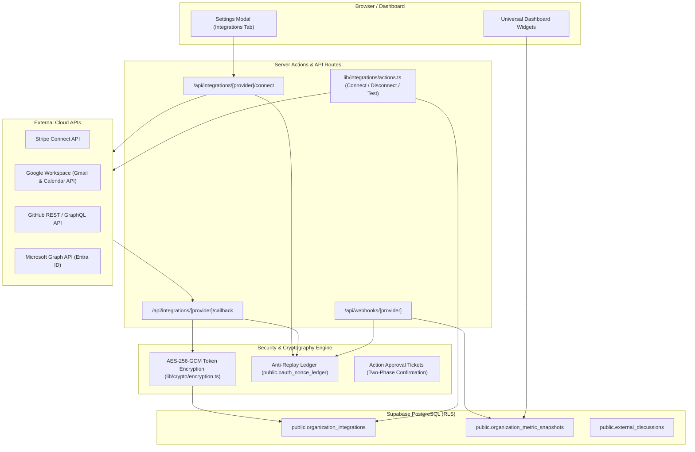

# Integrações Externas — Arquitetura, Segurança e Manual Operacional

> **Status**: Operacional & Homologado  
> **Escopo**: Stripe Connect, Google Workspace (Calendar & Gmail), GitHub, Microsoft 365 (Microsoft Graph) e UI de Gestão de Conexões.  
> **Segurança**: Tokens encriptados em repouso (AES-256-GCM), proteção anti-replay via ledger de nonces, isolamento estrito por organização (RLS) e validação criptográfica de webhooks.

---

## 1. Visão Geral da Arquitetura

O ecossistema de integrações do BusinessBrain permite sincronizar métricas financeiras, repositórios de código, comunicações e eventos de calendário mantendo estrita separação multi-tenant:

---

## 2. Especificação por Provider

### 2.1 Stripe (Stripe Connect & Analytics Financeiros)

- **Tipo de Integração**: Stripe Connect Standard (OAuth 2.0).
- **Finalidade**:
  1. *Faturação do BusinessBrain*: Cobrança de planos SaaS (`subscriptions`, `STRIPE_SECRET_KEY`).
  2. *Corporate Finance do Tenant*: Leitura das métricas financeiras reais da conta Stripe da organização (`STRIPE_CONNECT_CLIENT_ID`).
- **Scopes Solicitados**: `read_only` (respeita o princípio de menor privilégio para relatórios analíticos).
- **Redirect URI Autorizado**: `http://localhost:3000/api/integrations/stripe/callback`
- **Variáveis de Ambiente**:
  - `STRIPE_SECRET_KEY`: Chave secreta da plataforma (`sk_test_...` ou `sk_live_...`).
  - `STRIPE_CONNECT_CLIENT_ID`: Identificador da aplicação Connect (`ca_...`).
  - `STRIPE_WEBHOOK_SECRET`: Segredo de verificação das assinaturas dos webhooks (`whsec_...`).
- **Anti-Replay & CSRF**:
  - Nonce gerado criptograficamente com 16 bytes e registado em `oauth_nonce_ledger`.
  - Assinatura HMAC-SHA256 do payload de estado com expiração de 15 minutos.
  - Consumo atómico do nonce no callback (`consumeOAuthNonce`).
- **Sincronização & Deduplicação**:
  - `lib/integrations/stripe/analytics.ts` aplica cursores de paginação (`starting_after`) e conjuntos de deduplicação (`seenSubscriptionIds`, `seenBtIds`).
  - Distinção rigorosa entre ARR (Run-Rate anualizado = MRR × 12) e totais de período acumulados.
  - Suporte a múltiplas moedas com separação em buckets nativos (EUR, USD, GBP) sem conversão arbitrária.
- **Webhooks**:
  - `app/api/webhooks/stripe/route.ts` valida assinaturas via `stripe.webhooks.constructEvent`.
  - Eventos de plataforma: `checkout.session.completed`, `customer.subscription.*`, `invoice.*`.
  - Eventos de Connect: `account.application.deauthorized` desativa automaticamente a integração da organização quando o utilizador revoga o acesso no Dashboard Stripe.

---

### 2.2 Google Workspace (Google Calendar & Gmail)

- **Tipo de Integração**: OAuth 2.0 (Google Cloud Console).
- **Finalidade**:
  - Leitura de eventos e reuniões de calendário.
  - Leitura e criação de rascunhos de e-mail com confirmação em duas fases.
- **Scopes Mínimos**:
  - Perfil e Identificação: `userinfo.email`, `userinfo.profile`.
  - Gmail: `https://www.googleapis.com/auth/gmail.readonly`, `https://www.googleapis.com/auth/gmail.compose`.
  - Calendar: `https://www.googleapis.com/auth/calendar.readonly`, `https://www.googleapis.com/auth/calendar.events`.
  *(Nota: `gmail.modify` foi excluído por constituir um escopo restrito de alto risco que exige auditoria CASA Tier 2/3).*
- **Redirect URI Autorizado**: `http://localhost:3000/api/integrations/google/callback`
- **Variáveis de Ambiente**:
  - `GOOGLE_CLIENT_ID`: OAuth 2.0 Client ID do Google Cloud.
  - `GOOGLE_CLIENT_SECRET`: OAuth 2.0 Client Secret do Google Cloud.
  - `GOOGLE_REDIRECT_URI`: URL de callback (opcional se corresponder ao padrão).
- **Gestão de Tokens & Refresh**:
  - `lib/integrations/google/client.ts` verifica a expiração do token (`token_expires_at`). Se expirar em menos de 3 minutos, renova automaticamente via `refreshGoogleAccessToken(refreshToken)` e atualiza o registo encriptado.
  - Se a renovação falhar (ex.: token revogado), o estado da integração é automaticamente atualizado para `needs_reauth`.
- **SSRF Boundary**: Restrito aos domínios `*.googleapis.com` e `accounts.google.com`.

---

### 2.3 GitHub (Repositórios, Issues & Pull Requests)

- **Tipo de Integração**: GitHub OAuth App / GitHub App.
- **Finalidade**:
  - Listagem de repositórios autorizados da organização.
  - Acompanhamento de Pull Requests, Issues, lançamentos e atividade da equipa.
- **Scopes**: `repo`, `read:user`, `user:email`, `read:org`.
- **Redirect URI Autorizado**: `http://localhost:3000/api/integrations/github/callback`
- **Variáveis de Ambiente**:
  - `GITHUB_CLIENT_ID`: Client ID do GitHub OAuth.
  - `GITHUB_CLIENT_SECRET`: Client Secret do GitHub OAuth.
  - `GITHUB_WEBHOOK_SECRET`: Segredo HMAC para verificação de webhooks.
  - `GITHUB_APP_SLUG`: Slug opcional da GitHub App.
- **Auto-Recuperação em Revogação**:
  - Em chamadas à API que retornem `401 Bad Credentials`, o cliente marca imediatamente a integração como `needs_reauth` ou `disconnected` no banco de dados.
- **Webhooks**:
  - `app/api/webhooks/github/route.ts` valida assinaturas `x-hub-signature-256` em tempo constante.
  - Correspondência de repositórios por repositório predefinido (`default_repository`), lista de selecionados (`selected_repositories`) ou login de conta.

---

### 2.4 Microsoft 365 (Microsoft Graph / Outlook / Calendar)

- **Tipo de Integração**: Microsoft Entra ID (Azure Portal) Multi-Tenant App.
- **Finalidade**:
  - Sincronização de calendários do Outlook.
  - Leitura de mensagens de e-mail corporativas via Microsoft Graph.
- **Scopes**: `User.Read`, `Calendars.ReadWrite`, `Mail.Read`, `offline_access`.
- **Redirect URI Autorizado**: `http://localhost:3000/api/integrations/microsoft/callback`
- **Variáveis de Ambiente**:
  - `MICROSOFT_CLIENT_ID`: Application (client) ID gerado no Azure Entra ID.
  - `MICROSOFT_CLIENT_SECRET`: Client Secret gerado no Azure Entra ID.
  - `MICROSOFT_TENANT_ID`: `common` (para aplicações multi-tenant) ou ID específico do diretório Azure.
  - `MICROSOFT_REDIRECT_URI`: URL de callback.
- **Deteção de Configuração em Falta**:
  - O sistema identifica se as variáveis possuem valores padrão de placeholder (`your-microsoft-...`) e sinaliza na UI `Configuration Missing` (Configuração em Falta), impedindo redirecionamentos inválidos.
- **Tratamento de 401 & Renovação**:
  - `lib/integrations/microsoft/client.ts` interceta falhas de renovação e códigos 401, atualizando o registo para `needs_reauth`.

---

## 3. Estados Operacionais na Interface do Utilizador

A página de integrações ([`components/dashboard/settings/settings-modal.tsx`](file:///C:/Users/gonca/Documents/coding/Projects/BusinessBrain/components/dashboard/settings/settings-modal.tsx)) reflete 7 estados em tempo real:

| Estado Visual | Indicador | Ação Disponível | Descrição |
| :--- | :--- | :--- | :--- |
| **Connected** | Ponto verde (`bg-emerald-500`) | *Testar Conexão*, *Desconectar* | A integração está ativa, com credenciais válidas e dados sincronizados. |
| **Not Connected** | Botão *Conectar* | *Conectar* | O serviço está configurado no servidor mas não foi autorizado pela organização. |
| **Authorization Required** | Ponto âmbar (`bg-amber-400`) | *Reautorizar*, *Remover* | O token expirou ou foi revogado remotamente pelo utilizador. |
| **Configuration Missing** | Badge âmbar + Ícone de Ajuda | *Ver Variáveis* | As credenciais do provider não estão configuradas em `.env.local`. |
| **Token Expired** | Badge âmbar | *Reautorizar* | Token de acesso expirou e o refresh token é inválido. |
| **Permission Denied** | Ações desativadas | Nenhuma | O utilizador logado não tem permissão `integrations.connect` ou `integrations.disconnect`. |
| **Synchronization Error** | Ponto vermelho (`bg-rose-500`) | *Testar Conexão*, *Reautorizar* | A última chamada à API externa resultou em falha de rede ou erro 5xx. |

### Ação "Testar Conexão"
Disponível em [`testIntegrationConnectionAction`](file:///C:/Users/gonca/Documents/coding/Projects/BusinessBrain/lib/integrations/actions.ts):
1. Efetua uma chamada de verificação real à API do provider (Stripe Accounts, Google UserInfo, GitHub Viewer ou Microsoft Graph `/me`).
2. Atualiza `last_sync_at` com o timestamp atual em caso de sucesso.
3. Se detetar um erro 401, atualiza imediatamente o estado do registo para `needs_reauth`.
4. Devolve feedback inline ao utilizador no painel de configurações.

---

## 4. Segurança, Criptografia e Multi-Tenancy

1. **Tokens Encriptados em Repouso**:
   - Chaves de acesso e refresh tokens nunca são armazenados em texto simples.
   - Encriptação simétrica AES-256-GCM via [`lib/crypto/encryption.ts`](file:///C:/Users/gonca/Documents/coding/Projects/BusinessBrain/lib/crypto/encryption.ts) com IV único de 12 bytes e tag de autenticação de 16 bytes.
   - Suporte a rotação de chaves sem indisponibilidade via `INTEGRATION_TOKEN_ENCRYPTION_KEY_PREVIOUS`.
2. **Proteção Anti-Replay de OAuth**:
   - Todos os fluxos OAuth utilizam tokens de estado assinados com HMAC-SHA256 e nonces únicos.
   - O registo em `oauth_nonce_ledger` e a validação atómica impedem reutilização de URLs de callback.
3. **Isolamento por Organização (RLS)**:
   - Todas as tabelas de integração (`organization_integrations`, `oauth_nonce_ledger`, `organization_metric_snapshots`) contêm `organization_id` e políticas de segurança RLS baseadas nas funções de pertença (`public.has_org_role`).
4. **Proteção SSRF**:
   - Clientes de API implementam validações estritas de URLs, impedindo requisições para endereços locais, redes privadas (RFC 1918) ou metadados de cloud (`169.254.169.254`).
5. **Guardrails para Ações Sensíveis**:
   - Criação de eventos de calendário e envio de e-mails utilizam o sistema de tickets criptográficos em duas fases ([`ActionApprovalTicket`](file:///C:/Users/gonca/Documents/coding/Projects/BusinessBrain/lib/integrations/guardrails.ts)), prevenindo execução acidental ou ataques de injeção de parâmetros.
