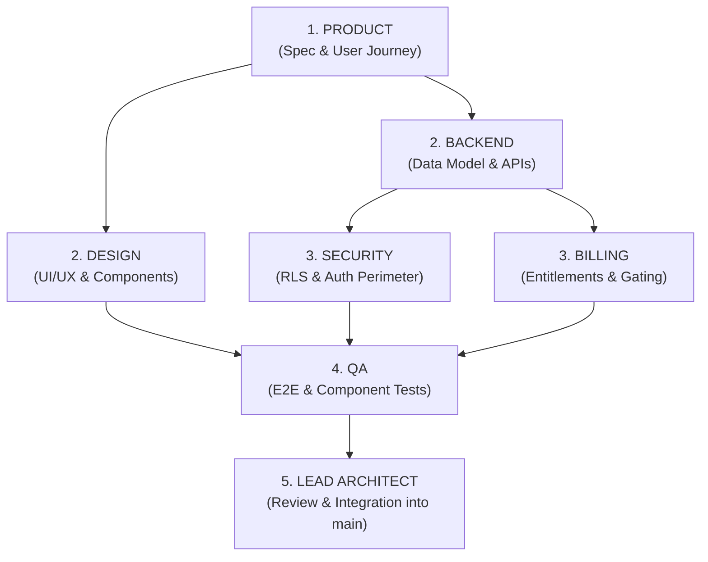

# Inter-Agent Dependencies & Interaction Matrix

In a complex multi-agent system, features frequently require coordination across multiple specializations. This document maps the primary dependencies and workflow pipelines across the six agents.

---

## 1. Primary Feature Pipeline

A typical new product feature follows this sequential or parallel dependency flow:

---

## 2. Cross-Agent Dependency Matrix

| Requester | Depends On | For What | Artifact Required |
|---|---|---|---|
| **DESIGN** | **PRODUCT** | Acceptance criteria, copy, user flow | Spec in `docs/specs/` |
| **DESIGN** | **BACKEND** | Server Action signatures, data shape | TypeScript types in `lib/` or `HANDOFF` ticket |
| **BACKEND** | **PRODUCT** | Business rules, entity relationships | Spec in `docs/specs/` |
| **BACKEND** | **SECURITY** | RLS policy approval, security review | Review in `docs/agent-coordination/handoffs/` |
| **SECURITY** | **BACKEND** | New database tables, API routes | Schema files, Route handlers |
| **SECURITY** | **BILLING** | Webhook verification, customer auth | Webhook handler diff |
| **BILLING** | **BACKEND** | Organization membership, tenant records | Org queries in `lib/organizations/` |
| **BILLING** | **SECURITY** | Secret isolation, webhook signature checks | Security check sign-off |
| **QA** | **ALL** | Feature completeness, testable surface | Handoff ticket marked `REVIEW` |
| **LEAD** | **QA** | Regression test results, typecheck clean | `npm test` passing log |

---

## 3. Handling Blocking Dependencies

When an agent cannot proceed because it is waiting for another agent:
1. **Never block silently**: Update `docs/agent-coordination/TASK_BOARD.md` setting status to `BLOCKED: by <Agent> / <TaskID>`.
2. **Issue an Unblock Request**: Create `docs/agent-coordination/handoffs/BLOCKED-<TASK_ID>.md` specifying exactly what interface, mock, or data shape is required.
3. **Use Mock Contracts (when possible)**:
   - Design can build against mock data shapes or TypeScript interface definitions while Backend implements the real queries.
   - Backend can write unit tests against interface signatures while Security drafts the RLS policy.
