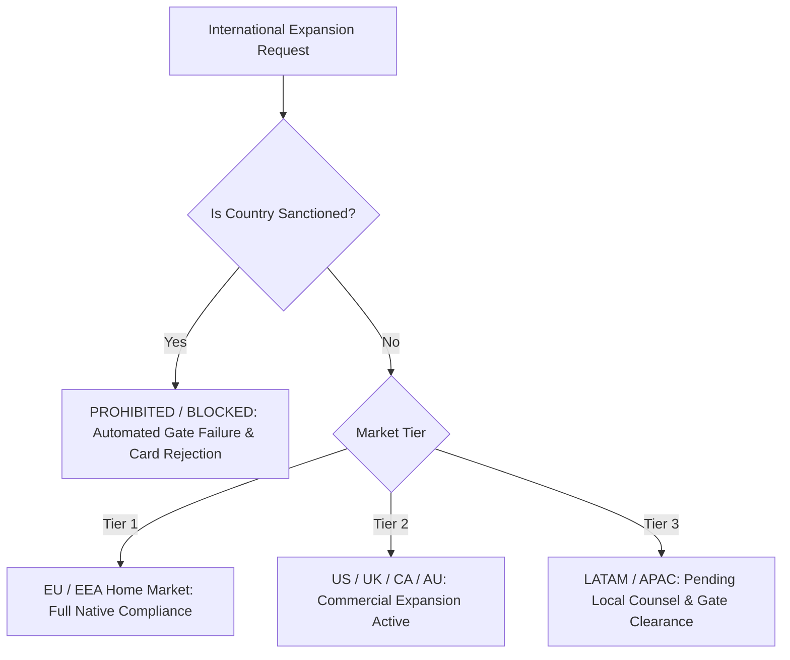

# BusinessBrain Global Market Entry & Sanctions Matrix

> **Scope**: Strategic classification of international markets by regulatory feasibility, sanctions barriers, consumer protection requirements, and localization obligations.  
> **Status**: Verified Governance Baseline  
> **Last Audited**: October 2026

---

## 1. Market Tiering Framework

---

## 2. Jurisdiction Evaluation Table

| Tier | Jurisdictions | Regulatory Regime | Commercial Feasibility | Required Localizations | Sanctions Status | Quality Gate Status |
| :--- | :--- | :--- | :--- | :--- | :--- | :--- |
| **Tier 1 (Home Market)** | **Portugal, Spain, France, Germany, EU/EEA** | GDPR, ePrivacy, EU Omnibus, EU AI Act, CIVA (PT) | **Immediate / Native** | 4 Supported Locales (EN, PT, ES, FR), EU VAT compliant invoicing, CIVA 10-year retention | None | **PASSED (Production Active)** |
| **Tier 2 (Expansion)** | **United States (Federal + CA, NY, TX)** | CCPA/CPRA, FTC Negative Option Rule, IRS 7-Year Rule, US Copyright Act | **Immediate / Active** | English UI, CCPA data deletion workflow, 1-click subscription cancellation | None | **PASSED (Production Active)** |
| **Tier 2 (Expansion)** | **United Kingdom** | UK GDPR, Data Protection Act 2018, Consumer Rights Act 2015 | **Immediate / Active** | UK adequacy alignment, English UI, VAT reverse charge | None | **PASSED (Production Active)** |
| **Tier 2 (Expansion)** | **Canada (Federal + Quebec)** | PIPEDA, Quebec Law 25, Canada Anti-Spam Legislation (CASL) | **Immediate / Active** | Bilingual EN/FR support natively implemented, CASL opt-in marketing consent | None | **PASSED (Production Active)** |
| **Tier 3 (Next Wave)** | **Brazil** | LGPD (Lei 13.709/2018), Código de Defesa do Consumidor (CDC) | **Conditionally Approved** | Portuguese UI natively supported; requires designated local DPO if localized legal entity is formed | None | **CONDITIONAL: [OWNER_INPUT_REQUIRED: Brazilian DPO appointment]** |
| **Tier 3 (Next Wave)** | **Australia & New Zealand** | Privacy Act 1988 (APPs), Australian Consumer Law (ACL) | **Approved** | English UI natively supported; standard refund/cancellation disclosures | None | **PASSED** |
| **Prohibited / Sanctioned** | **Cuba, Iran, North Korea, Syria, Russian-occupied regions of Ukraine (Crimea, Donetsk, Luhansk, Zaporizhzhia, Kherson)** | OFAC 31 CFR Part 500, EU Sanctions Reg 833/2014, UK Sanctions Act 2018 | **STRICTLY PROHIBITED** | Not Applicable (Zero Commercial Activity Permitted) | **COMPREHENSIVE SANCTIONS** | **BLOCKED: Hard validation in `lib/compliance/markets.config.ts` rejects any entry.** |

---

## 3. Sanction Blocking Architecture

1. **Deterministic Sanction Guard**: `lib/compliance/markets.config.ts` exports `isCountrySanctioned(countryCode: string): { sanctioned: boolean; regime?: string; reason?: string }`.
2. **Checkout Barrier**: Any checkout session initialized with a card issuing country or billing country identified in the sanctions register is immediately rejected.
3. **Quality Gate Failure**: If any configuration file (`config/markets.json`) attempts to toggle a sanctioned market to active, `scripts/verify-compliance-gate.ts` triggers an exit code 1 build abort.
