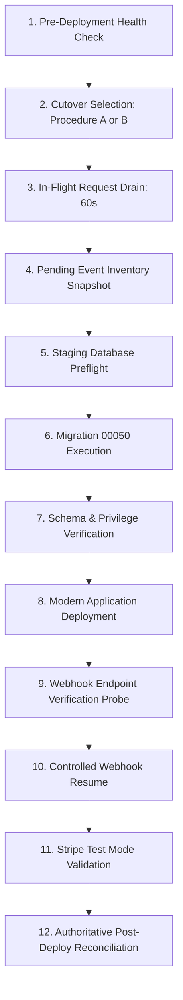

# Stripe Migration 00050 — Deployment & Rollback Operational Playbook

> **Scope**: Migration `00050_stripe_integrity_and_monotonic_ordering.sql` & Rollback `00050_rollback_stripe_integrity_and_monotonic_ordering.sql`  
> **Status**: STAGING REVIEW APPROVED — Anti-Poisoning & Security Hardened  
> **Author**: Lead Architecture & Security Operations  
> **Target Environment**: Supabase PostgreSQL + Vercel Serverless (Next.js App Router)

---

## 1. Architectural Compatibility & Anti-Poisoning Architecture

### 1.1 The Premature Completion Poisoning Flaw
In earlier proposals, the legacy 3-argument caller path in `record_stripe_webhook_event` directly inserted new rows with `status = 'completed'` and returned `true` to the old application.
Because the old application performs subscription mutations (`sync_stripe_subscription`) *after* `record_stripe_webhook_event` returns:
- If subscription processing failed (e.g. Stripe API rate-limit, network drop, PostgreSQL lock contention), the ledger had already recorded the event as `completed`.
- When Stripe retried the webhook minutes later, the retry saw `status = 'completed'`, treated the event as a duplicate, and permanently dropped it without processing.
- This resulted in missed plan upgrades, subscription cancellations, or trial adjustments (**Event Poisoning**).

### 1.2 The Corrected Anti-Poisoning Architecture
The ledger implements explicit state separation between legacy callers and modern workers:
1. **Legacy Callers (`p_lease_token IS NULL`)**:
   - Recorded in **`legacy_processing`** status with a bounded lease (`lease_expires_at = now() + 120s`) and `lease_token = 'legacy_unfenced'`.
   - **CRITICAL**: An event is **NEVER** marked `completed` at recording time.
   - If business processing succeeds, the subscription is mutated and Stripe receives HTTP 200 (no retry occurs).
   - If business processing fails, the old application returns HTTP 500. When Stripe retries after lease expiration (`now() >= lease_expires_at`), the retry reclaims the uncompleted lease and successfully recovers the mutation (**Zero Poisoning**).
2. **Modern Callers (`p_lease_token IS NOT NULL`)**:
   - Recorded in **`processing`** status with a dedicated UUID worker fencing token (`lease_token = p_lease_token`, `lease_expires_at = now() + 120s`).
   - Completion (`complete_stripe_webhook_event`) and failure (`fail_stripe_webhook_event`) require exact fencing token matches (`lease_token = p_lease_token`).

### 1.3 The Legacy Lifecycle Gap & Analysis of Architecture Options
The unmodified old application code (`app/api/webhooks/stripe/route.ts` at git baseline):
1. Calls `record_stripe_webhook_event(event.id, event.type)` with 3 arguments.
2. Calls external Stripe API `await stripe.subscriptions.retrieve(subscriptionId)` over HTTPS.
3. Calls `sync_stripe_subscription(11 args)` (without passing `event.id` or `stripe_event_created`).
4. **Never calls `complete_stripe_webhook_event` or any post-processing callback.**
5. Returns HTTP 200 to Stripe.

Because the old application has no completion call, any event processed by an unmodified legacy worker remains in `legacy_processing`. After 120 seconds, its lease expires. While Stripe does not retry after receiving HTTP 200, manual resends or delayed duplicate network deliveries could re-read Stripe and re-invoke `sync_stripe_subscription`.

#### Evaluation of Architectural Approaches:
- **Option B (Move legacy processing into a single database transaction)**:  
  **DISQUALIFIED & PHYSICALLY IMPOSSIBLE**. The old webhook handler invokes `stripe.subscriptions.retrieve()` over HTTPS to Stripe's REST API between ledger acquisition and subscription mutation. PostgreSQL functions cannot make external HTTP requests, and PostgREST operates as stateless HTTP requests without multi-turn long-lived connection transactions.
- **Option C (Idempotent mutations & distinct legacy state)**:  
  **INSUFFICIENT ON ITS OWN**. While subscription upserts are idempotent, leaving events in `legacy_processing` permanently pollutes the ledger with expired leases and makes it impossible to distinguish successful runs from abandoned crashes.
- **Option A (Application Compatibility Release Deployed First / Expand-Contract)**:  
  Deploying an application release that introduces explicit completion and error handling provides clean lifecycle sealing, but requires coordinated deployment steps.
- **Option D (Controlled Webhook Rollout / Zero-Overlap Transition)**:  
  **THE SAFEST PRODUCTION ARCHITECTURE**. Temporarily pausing webhook processing or returning HTTP 503 during the short migration window guarantees that **zero legacy workers execute concurrently with modern workers**. Stripe's retry engine provides automatic exponential backoff retries over up to 3 days on 5xx responses, delivering directly to the modern application once unpaused. Authoritative post-cutover reconciliation serves as the secondary safety net.

#### Recommended Architecture: The Unified Hybrid (Option A + Option C Defense-in-Depth + Option D Operational Cutover)
1. **Database Schema (Migration 00050)** incorporates **Option C's Monotonic Defense-in-Depth**:
   - `sync_stripe_subscription` and `cancel_stripe_subscription` explicitly block any caller with `excluded.stripe_event_created IS NULL` from downgrading or resurrecting any subscription record that has `public.subscriptions.stripe_event_created IS NOT NULL`.
   - Preserves 3-argument overloads as safe fallbacks.
2. **Operational Deployment** enforces **Option D (Controlled Zero-Overlap Rollout)**:
   - Eliminates concurrent legacy worker races during deployment.

### 1.4 Critical Stale Worker Fencing & Monotonic Protection in SQL
Consider the race condition:
1. Legacy Worker A claims event E1 at T1 (`legacy_processing`, 120s lease).
2. Worker A stalls for >120s due to an external Stripe API network latency spike.
3. Modern Worker B reclaims event E1 (or processes a newer cancellation event E2 at T2 > T1), updating the database to `status = 'canceled'` with `stripe_event_created = T2`.
4. Worker A resumes and calls `sync_stripe_subscription` with `p_stripe_event_created = NULL`.
5. **The Hardened SQL Invariant**:
   In `sync_stripe_subscription`:
   ```sql
   -- Legacy / unversioned update (excluded.stripe_event_created IS NULL):
   -- Can ONLY update if the target record also has no monotonic timestamp (baseline).
   -- If target record already has a monotonic timestamp (T2), legacy unversioned callers CANNOT overwrite!
   when excluded.stripe_event_created is null and public.subscriptions.stripe_event_created is null
     then excluded.status
   else public.subscriptions.status
   ```
   Because `public.subscriptions.stripe_event_created` is `T2` (NOT NULL), the incoming legacy write is **REJECTED** and `public.subscriptions.status` remains `'canceled'`! The subscription is NOT resurrected.
6. Similarly in `cancel_stripe_subscription`:
   A delayed legacy cancellation with `NULL` timestamp cannot cancel an active subscription that was renewed/updated by a modern event with a known timestamp.

3. **Security Boundary Hardening**:
   - The arbitrary `length(p_server_token) < 32` check has been replaced with an explicit check that unconditionally rejects anonymous and authenticated client roles (`if coalesce(auth.role(), '') in ('anon', 'authenticated') or current_user in ('anon', 'authenticated') then raise exception ... using errcode = '42501'`).
   - Only genuine `service_role` and `postgres` execution contexts are authorized.

---

## 2. Complete State-Transition Table

| Current State | Event / Trigger | Caller Type | Guard Condition | Next State | Action / Return | Architectural Guarantee |
| :--- | :--- | :--- | :--- | :--- | :--- | :--- |
| **Non-existent (New)** | `record_stripe_webhook_event` | Modern (4-arg) | `p_lease_token IS NOT NULL` | **`processing`** | Inserts row with `lease_token = p_lease_token`. Returns `true`. | Fenced modern lease established. |
| **Non-existent (New)** | `record_stripe_webhook_event` | Legacy (3-arg) | `p_lease_token IS NULL` | **`legacy_processing`** | Inserts row with `lease_token = 'legacy_unfenced'`. Returns `true`. | **No premature completion.** Never marked completed before processing succeeds. |
| **`processing` (Active)** | `record_stripe_webhook_event` | Any | `now() < lease_expires_at` | **`processing`** | Returns `false`. | Active worker protected; duplicate webhooks blocked. |
| **`legacy_processing` (Active)** | `record_stripe_webhook_event` | Any | `now() < lease_expires_at` | **`legacy_processing`** | Returns `false`. | In-flight legacy worker protected against concurrent duplicates. |
| **`processing` (Expired)** | `record_stripe_webhook_event` | Modern (4-arg) | `now() >= lease_expires_at` | **`processing`** | Updates `lease_token = new_token`, increments `attempt_count`. Returns `true`. | **Lease reclaimed.** Crashed/timed-out modern worker recovered. |
| **`processing` (Expired)** | `record_stripe_webhook_event` | Legacy (3-arg) | `now() >= lease_expires_at` | **`legacy_processing`** | Updates to `legacy_processing`, increments `attempt_count`. Returns `true`. | Expired modern worker recovered by legacy retry. Not poisoned. |
| **`legacy_processing` (Expired)** | `record_stripe_webhook_event` | Modern (4-arg) | `now() >= lease_expires_at` | **`processing`** | Reclaims to `processing` with modern UUID token. Returns `true`. | Failed/uncompleted legacy event recovered by modern worker on retry. |
| **`legacy_processing` (Expired)** | `record_stripe_webhook_event` | Legacy (3-arg) | `now() >= lease_expires_at` | **`legacy_processing`** | Resets `lease_expires_at`, increments `attempt_count`. Returns `true`. | **Failed legacy processing retryable.** Old app failure recovers on retry. |
| **`failed` (Explicit)** | `record_stripe_webhook_event` | Modern (4-arg) | `status = 'failed'` | **`processing`** | Reclaims lease, clears `error_message`. Returns `true`. | Immediate retry reclamation without waiting for expiry. |
| **`failed` (Explicit)** | `record_stripe_webhook_event` | Legacy (3-arg) | `status = 'failed'` | **`legacy_processing`** | Reclaims to `legacy_processing`, clears error. Returns `true`. | Immediate legacy retry reclamation without premature completion. |
| **`processing` (Active)** | `complete_stripe_webhook_event` | Modern (4-arg) | `lease_token = p_lease_token` | **`completed`** | Sets `status = 'completed'`, clears lease. Returns `true`. | **Verified completion.** Only active lease owner can seal event. |
| **`processing` (Reclaimed)** | `complete_stripe_webhook_event` | Expired Owner | `lease_token <> p_lease_token` | **`processing`** | Returns `false`. | **Fencing defense.** Stalled worker whose lease was reclaimed cannot complete. |
| **`processing` (Active)** | `fail_stripe_webhook_event` | Modern (4-arg) | `lease_token = p_lease_token` | **`failed`** | Sets `status = 'failed'`, records `error_message`. Returns `true`. | Explicit failure allows immediate retry reclamation. |
| **`completed` (Terminal)** | `record_stripe_webhook_event` | Any | `status = 'completed'` | **`completed`** | Returns `false`. | **Strict idempotency.** Completed events never re-executed. |
| **`completed` (Terminal)** | `complete_stripe_webhook_event` | Any | `status = 'completed'` | **`completed`** | Returns `false`. | Already completed. |
| **`completed` (Terminal)** | `fail_stripe_webhook_event` | Any | `status = 'completed'` | **`completed`** | Returns `false`. | Completed events cannot be failed retroactively. |

---

## 3. Lease Lifecycle & Execution Budget Assessment

### 3.1 Concrete Configuration References
- **Next.js App Router Route Handler Configuration** (`app/api/webhooks/stripe/route.ts`):
  ```typescript
  export const maxDuration = 60; // Hard Vercel hypervisor execution limit (60s)
  export const dynamic = "force-dynamic";
  ```
- **Stripe SDK Client Configuration** (`lib/stripe/client.ts`):
  ```typescript
  timeout: 15000, // Explicit 15-second bounded network timeout
  maxNetworkRetries: 2,
  ```
- **PostgreSQL Database Lease Duration** (`00050_stripe_integrity_and_monotonic_ordering.sql`):
  ```sql
  v_lease_duration interval := interval '120 seconds';
  ```

### 3.2 Operational Execution Limits & Defense-in-Depth Assessment
> [!IMPORTANT]
> A 120-second lease duration alone does **not** physically eliminate worker overlap across all possible failure modes (such as edge runtime freezes, stalled event-loop promises, or network partitions).
> True defense-in-depth is enforced by the **combination** of three decoupled layers:
> 1. **Worker Fencing Tokens**: Expired workers whose lease was reclaimed are fenced out and cannot seal the ledger (`complete_stripe_webhook_event`).
> 2. **Monotonic Event Timestamps in PostgreSQL**: Even if a stale worker unfreezes and calls `sync_stripe_subscription`, `stripe_event_created` ensures older events cannot overwrite newer state.
> 3. **Elimination of Direct Table Upserts**: All subscription writes pass exclusively through database RPCs, preventing any bypass of monotonic ordering.

#### Runtime Limit Verification (Source Code vs Remote Settings):
- **Configured in Source Code**:
  - `export const maxDuration = 60;` in `route.ts`.
  - `timeout: 15000` (15s) and `maxNetworkRetries: 2` in `lib/stripe/client.ts`.
  - `v_lease_duration interval := interval '120 seconds';` in migration 00050.
- **Requires Remote Staging Verification**:
  - The effective function execution limit depends on the Vercel project plan tier (Hobby plan caps functions at 10s regardless of `maxDuration = 60`; Pro plan allows 60s). Operators must verify the active plan duration in Vercel settings.
  - Stripe retries follow exponential backoff over up to 3 days on HTTP 5xx responses, but are not an unconditional guarantee against prolonged infrastructure outages or endpoint configuration deletions. Continuous monitoring and authoritative post-cutover reconciliation are mandatory.

---

## 4. Security Model Reassessment & Privilege Audit

### 4.1 Effective Role Identity in PostgreSQL SECURITY DEFINER Functions
- **The PostgreSQL Behavior**: Inside a `SECURITY DEFINER` function, PostgreSQL sets `current_user` to the **function owner** (`postgres`).
- **Initial Vulnerability**: Checking `if current_user in ('anon', 'authenticated')` inside a `SECURITY DEFINER` function owned by `postgres` would NEVER evaluate to true, because `current_user` has already switched to `postgres`.
- **The Corrected Guard**:
  ```sql
  if session_user in ('anon', 'authenticated') 
     or coalesce(nullif(current_setting('request.jwt.claim.role', true), ''), auth.role(), '') in ('anon', 'authenticated') 
  then
    raise exception 'Access denied: requires service_role boundary' using errcode = '42501';
  end if;
  ```
- **Privilege Revocation**: Execution is explicitly revoked from `public`, `anon`, and `authenticated` (`REVOKE ALL ON FUNCTION ... FROM public, anon, authenticated;`). PostgreSQL evaluates EXECUTE permissions at call time prior to entering the function. Non-service_role calls are rejected with `42501` at the gateway.
- **Search-Path Injection Defense**:
  All 5 functions enforce:
  ```sql
  set search_path = public, pg_temp;
  ```
  Every table reference is schema-qualified (`public.subscriptions`, `public.stripe_webhook_events`), physically preventing temporary table shadowing or search path hijacking.

---

## 5. Verifiable Webhook Cutover Mechanism

### 5.1 The Cutover Guard (`STRIPE_WEBHOOKS_PAUSED`)
In `app/api/webhooks/stripe/route.ts`:
```typescript
if (process.env.STRIPE_WEBHOOKS_PAUSED === "true") {
  logger.warn("[Stripe Webhook Cutover] Ingestion paused for deployment/migration. Returning retryable HTTP 503.");
  return new NextResponse(
    JSON.stringify({
      error: "Service Temporarily Unavailable",
      message: "Webhook processing is temporarily paused for scheduled migration cutover. Please retry.",
      retryable: true,
    }),
    {
      status: 503,
      headers: {
        "Content-Type": "application/json",
        "Retry-After": "30",
      },
    }
  );
}
```

### 5.2 The Database Contract Readiness Guard
If the modern application is deployed while the database migration 00050 has not yet been applied, `record_stripe_webhook_event` returns `ledgerError`.
Instead of falling back to an unversioned table update, the endpoint immediately returns HTTP 503 with `Retry-After: 30`.
The route immediately halts and returns HTTP 503 if the database schema lacks the required migration 00050 contract, preventing unversioned writes.

---

## 6. Authoritative Legacy Ledger Reconciliation Procedure

Command: `npx tsx scripts/reconcile-stripe-ledger.ts`

The reconciliation engine inspects all events in `legacy_processing` or `processing`:
1. **In-Flight Active Events (`now() < lease_expires_at`)**: Skipped and not disturbed.
2. **Expired Events Matching Authoritative Stripe State**:
   - Compared against `stripe.subscriptions.retrieve()`.
   - If DB `plan` and `status` match Stripe: marked `completed` with audit note `Reconciled: verified matching authoritative Stripe state`.
3. **Expired Events with Outdated DB State**:
   - Forward-synchronized to Stripe authoritative state via `sync_stripe_subscription`.
   - Marked `completed` with audit note `Reconciled: forward-synced subscription to authoritative Stripe state`.
4. **Unknown / Unresolvable Events (Stripe 404 / Missing Object)**:
   - Marked `failed` with error message `Reconciliation: Stripe event unresolvable. Flagged for manual audit`.
   - **NEVER marked completed solely because its lease expired.**

---

## 7. Executable 12-Stage Deployment & Rollback Runbook



### Critical Operational Finding: Vercel Environment Variable Reality
> [!WARNING]
> Changing `STRIPE_WEBHOOKS_PAUSED="true"` in Vercel Project Settings has **zero effect on already-running deployments**.
> Serverless functions run within immutable build snapshots. Furthermore, the currently deployed old application code contains **no logic checking `STRIPE_WEBHOOKS_PAUSED`**.
> Therefore, setting the environment variable alone without deploying code will NOT pause incoming webhooks.

### Two Approved Cutover Strategies:

#### Procedure A: Controlled Pause with Verified HTTP 503 (Strict Zero-Overlap)
Use when business operations require absolute cessation of webhook processing during schema cutover.
1. In Vercel Project Settings, set `STRIPE_WEBHOOKS_PAUSED="true"`.
2. Deploy the modern application code to Vercel (Initial Paused Deployment).
3. **Mandatory Probe Verification**: Execute `curl -i -X POST https://<staging-domain>/api/webhooks/stripe`.
   - **MUST** observe HTTP 503 with header `Retry-After: 30`.
   - If HTTP 503 is not returned, **ABORT IMMEDIATELY**.
4. Drain in-flight requests for 60 seconds (Stage 3).
5. Apply Migration 00050 in Supabase (Stage 6).
6. Verify schema and privileges (Stage 7).
7. In Vercel, set `STRIPE_WEBHOOKS_PAUSED="false"` and trigger redeployment (Unpause Deployment).
8. Probe endpoint with dummy payload: expect HTTP 400 `Invalid webhook signature` (Stage 9).
9. Run reconciliation (Stage 12).

#### Procedure B: Expand-Contract Cutover (Zero-Downtime — Recommended by Default)
Because Migration 00050 is 100% backward compatible (preserving 3-argument legacy RPC signatures with anti-poisoning `legacy_processing` status and monotonic timestamp protection):
1. Apply Migration 00050 first (Stage 6).
   - Old application continues serving webhooks normally.
   - Events are recorded in `legacy_processing` with 120s lease; premature completion poisoning is physically impossible.
2. Deploy modern application build to Vercel (Stage 8).
   - New workers immediately use 4-argument fenced RPCs and monotonic timestamps.
   - Built-in Contract Readiness Guard: If the application lands before migration completes, `record_stripe_webhook_event` returns `ledgerError`, automatically triggering HTTP 503 with `Retry-After: 30`.
3. Run authoritative reconciliation to seal any legacy events (Stage 12).

---

### Detailed Stage Instructions (Procedure A Path)

### Stage 1: Pre-Deployment Health Check
- Command: `npm run typecheck && npm run lint && npx tsx scripts/test-stripe-migration-00050-compat.ts && npx tsx scripts/test-checkout-webhook-entitlement.ts`
- Verification: 107/107 compatibility tests pass, 159/159 entitlement tests pass, 0 type errors, 0 lint errors.
- Failure Path: Abort deployment; do not touch database or production.

### Stage 2: Webhook Pause Activation & Probe
- Action: In Vercel Project Settings, set `STRIPE_WEBHOOKS_PAUSED="true"` and deploy modern application.
- Verification: Send probe webhook request: `curl -i -X POST https://<staging-domain>/api/webhooks/stripe`.
  - Expect: HTTP 503 response with `Retry-After: 30` header and body `Service Temporarily Unavailable`.
- Failure Path: If 503 is not returned, abort; do not proceed with migration.

### Stage 3: In-Flight Request Draining
- Action: Wait **60 seconds** (the configured `maxDuration`).
- Verification: Check Vercel function runtime logs; confirm zero active invocations on `/api/webhooks/stripe`.
- Failure Path: If in-flight requests linger, wait up to an additional 30 seconds before proceeding.

### Stage 4: Pending Event Inventory Snapshot
- Action: Execute inventory query:
  `select status, count(*) from public.stripe_webhook_events group by status;`
- Record snapshot count of any existing `legacy_processing` or `processing` rows.

### Stage 5: Staging Database Preflight
- Verification: Verify no conflicting table locks or active long-running transactions on `subscriptions` or `stripe_webhook_events`.

### Stage 6: Migration 00050 Execution
- Action: Apply `00050_stripe_integrity_and_monotonic_ordering.sql` via Supabase migration CLI or SQL Editor.
- Verification: Migration commits with `COMMIT;`. Post-execution assertion block passes. Schema cache reload signal emitted.
- Failure Path: If migration errors, transaction rolls back automatically (enclosed in `BEGIN ... COMMIT`). Baseline schema remains intact.

### Stage 7: Database Schema & Privilege Verification
- Verification Queries:
  ```sql
  select column_name from information_schema.columns where table_name = 'subscriptions' and column_name = 'stripe_event_created';
  select proname from pg_proc where proname = 'record_stripe_webhook_event';
  ```
- Failure Path: If unexpected state, execute `00050_rollback_stripe_integrity_and_monotonic_ordering.sql`.

### Stage 8: Modern Application Unpause Deployment
- Action: In Vercel, set `STRIPE_WEBHOOKS_PAUSED="false"` and deploy (Production Cutover).
- Verification: Build finishes with exit code 0; deployment URL is live.
- Failure Path: Roll back application to previous deployment in Vercel. Because Migration 00050 preserves 3-argument legacy RPCs with monotonic protection, old application continues processing safely without error.

### Stage 9: Webhook Endpoint Verification Probe
- Action: Invoke `/api/webhooks/stripe` health/readiness check with an invalid signature (`curl -i -X POST https://<staging-domain>/api/webhooks/stripe -d '{"test":true}' -H "stripe-signature: invalid"`).
- Verification: Expect HTTP 400 `Invalid webhook signature` (proves endpoint is live, unpaused, and validating signatures).

### Stage 10: Controlled Webhook Resume & Monitoring
- Action: Stripe webhook delivery resumes automatically as retries arrive. Monitor real-time logs for HTTP 200 responses.
- Failure Path: Re-enable `STRIPE_WEBHOOKS_PAUSED="true"` immediately if errors spike.

### Stage 11: Stripe Test Mode Operational Validation
- Action: Trigger test event `customer.subscription.updated` via Stripe CLI or Dashboard.
- Verification: Webhook recorded in `processing` with UUID lease token, subscription updated with monotonic timestamp, and ledger sealed to `completed`.

### Stage 12: Authoritative Post-Deployment Reconciliation
- Action: Execute `npx tsx scripts/reconcile-stripe-ledger.ts`.
- Verification: Reconciles any legacy events left over from pre-cutover traffic. Zero events remain in `legacy_processing`.

---

## 8. Rollback Procedures & Backward Compatibility

### Scenario 1: New Application Rolled Back (Code Defect Discovered)
1. In Vercel, trigger Instant Rollback to previous deployment.
2. Wait 60 seconds for in-flight modern serverless instances to drain.
3. The old application receives webhooks and records in `legacy_processing` against Migration 00050 with 100% success.
4. **Recommendation**: Leave Migration 00050 applied (Forward-Fix). Migration 00050 is 100% backward-compatible with the old application and protects against stale legacy overwrites.

### Scenario 2: Database Rollback Required
> [!CAUTION]
> **STRICT EXECUTION ORDER**: The application MUST be rolled back or paused in Vercel **BEFORE** applying database rollback SQL!
> If database rollback SQL is applied while modern application code is live, modern workers will immediately crash when calling `complete_stripe_webhook_event` or 4-argument `record_stripe_webhook_event`.

1. **Step 1**: In Vercel, trigger Instant Rollback to the previous application deployment (or activate Webhook Pause).
2. **Step 2**: Wait 60 seconds for in-flight modern serverless instances to drain.
3. **Step 3**: Verify via logs that no modern workers are executing.
4. **Step 4**: Execute `00050_rollback_stripe_integrity_and_monotonic_ordering.sql` in Supabase.
5. **Step 5**: If pause was activated, unpause and resume traffic.
6. **Step 6**: Verify old application processes webhooks against restored baseline database schema.
